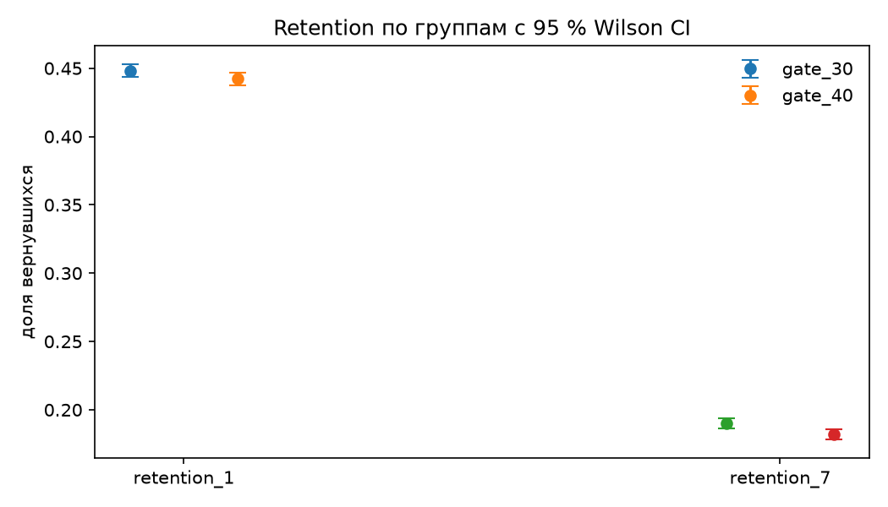
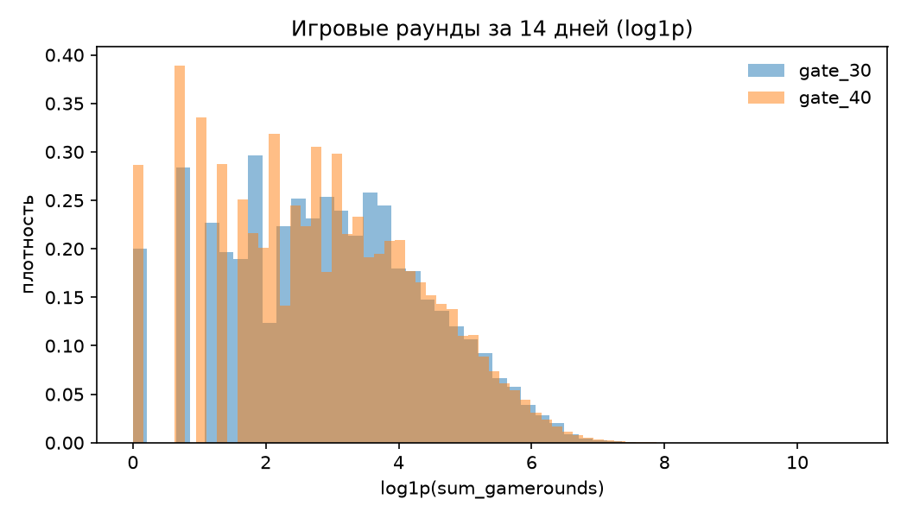
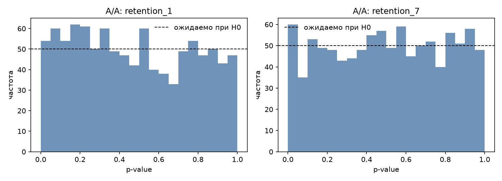
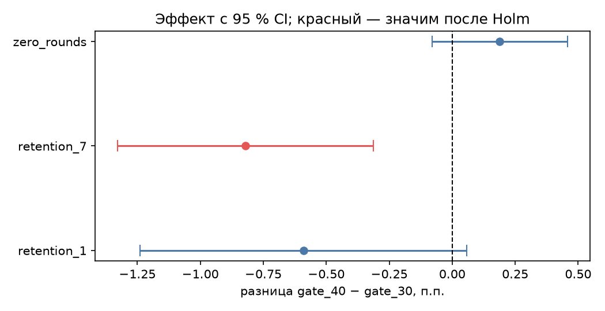
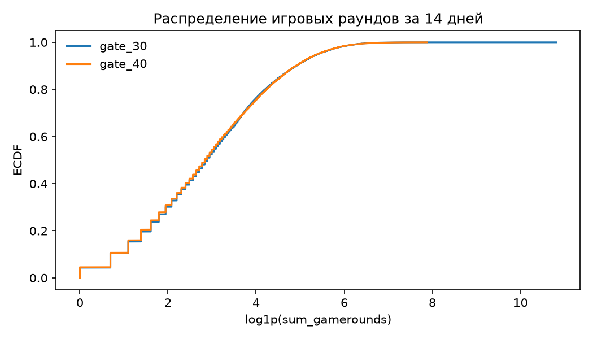
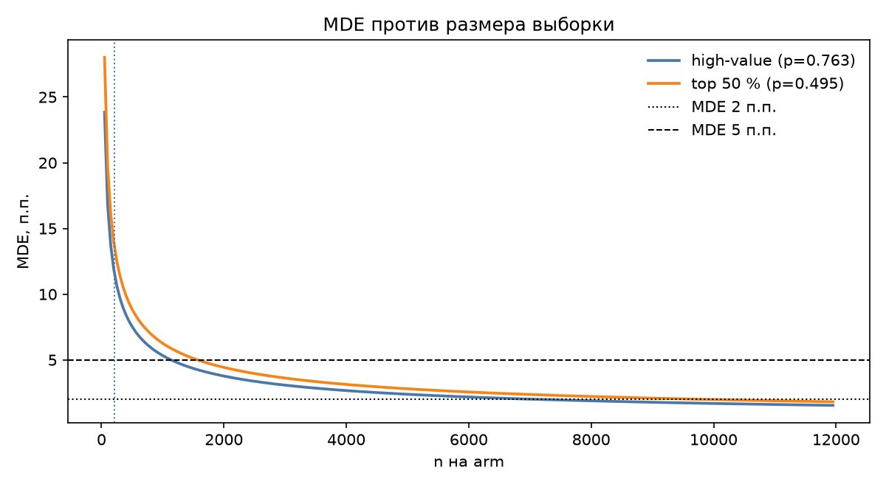
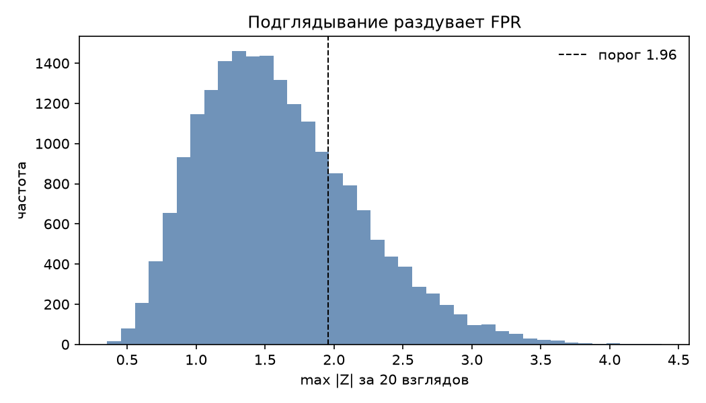

# A/B: дизайн теста и анализ Cookie Cats

**TL;DR.** Не раскатывать `gate_40`: 7-дневный retention ниже на 0.82 п.п. (95 % CI −1.33…−0.31), Holm p = 0.0062, и эффект сохраняется после SRM-downsampling. Для high-value сегмента LTV классический тест нереалистичен: MDE 11.7 п.п. при 417 клиентах, для 5 п.п. нужно 1 137 клиентов на arm.

## Вопрос

Кейс состоит из двух частей, и это его особенность.

**Part 1 — дизайн.** Персонализированная механика для high-value сегмента LTV (9.8 % клиентов, порог £3 580, 60.1 % выручки holdout) должна поднять долю клиентов с повторной покупкой в 90 дней. Вопрос: как спроектировать тест, который отличит эффект от сезонности, не сломает маржу и CAC и вообще способен что-то доказать на этом сегменте.

**Part 2 — анализ.** В Cookie Cats перенесли первый gate с уровня 30 на 40. Вопрос: улучшает ли это retention и стоит ли раскатывать изменение. Ответ нужен не только «значимо / не значимо», но и «можно ли верить сплиту».

## Данные

**Part 2 — Cookie Cats.** 90 189 игроков, 44 700 в `gate_30` и 45 489 в `gate_40`. Колонки: `userid`, `version`, `sum_gamerounds` (раунды за 14 дней), `retention_1`, `retention_7` (bool). Пропусков и дублей `userid` нет; `sum_gamerounds` от 0 до 49 854, нулевых 3 994.

Источник — открытый проект DataCamp 184 / зеркала Kaggle. **Лицензия источника не подтверждена**, поэтому CSV в репозиторий не входит: публикуются только агрегаты и графики. Перед переиспользованием данных проверьте условия источника.

**Part 1 — LTV-данные.** 4 239 клиентов калибровки LTV; high-value сегмент — 417 клиентов по порогу £3 580. Для дизайна считаю 90-дневный holdout: доля клиентов с покупкой в первые 90 дней после cutoff. Это тот же датасет Online Retail II, что и в LTV-кейсе; данные вне git.

## Определение метрики

**Part 2.** Primary — `retention_1` и `retention_7`, разница `gate_40 − gate_30` в процентных пунктах, two-sided, α = 0.05. Guardrails — доля нулевых раундов и медиана `sum_gamerounds`. Единица — игрок; один `userid` не попадает в обе группы.

**Part 1.** Primary — доля клиентов с повторной покупкой в 90 дней. Secondary — 90-day net revenue per customer. Guardrails — маржа, CAC, refund rate, unsubscribe rate. Alpha 0.05, power 0.80, two-sided; primary один, secondary и guardrails — Holm. Горизонт фиксированный, 90 дней; подглядывание запрещено.

**SRM.** Проверяю размеры групп хи-квадратом против 50/50. Порог жёсткой остановки — p < 0.001; p < 0.01 — предупреждение. SRM не доказывает смещение само по себе, но означает, что сплит или логирование надо объяснить до интерпретации эффекта.

## Метод

**Part 2.**
- SRM: `scipy.stats.chisquare` на размерах групп.
- A/A placebo: 1 000 случайных разбиений пула 50/50; проверяю долю p < 0.05. Это проверка пайплайна, а не реального сплита.
- Эффект: two-proportion z-test, нормальный 95 % CI для разницы, Wilson CI для долей.
- Множественные метрики: Holm по retention и guardrails.
- SRM-чувствительность: 1 000 раз уменьшаю `gate_40` до размера `gate_30` (44 700) и пересчитываю эффект.
- Guardrail `sum_gamerounds`: Mann–Whitney и bootstrap CI для разницы медиан; распределение тяжёлое, среднее не использую как основной критерий.

**Part 1.**
- Baseline и дисперсия — из 90-дневного holdout LTV.
- MDE для двух пропорций: `(z_{1−α/2} + z_{1−β}) · sqrt(2p(1−p)/n_arm)`; обратная формула для требуемого n.
- CUPED: ковариата — историческая выручка `revenue_cal`; выигрыш `1 − ρ²`.
- Подглядывание: 20 000 траекторий Z-статистики под H0, 20 взглядов; сравниваю FPR с фиксированным горизонтом.



*Доли вернувшихся с 95 % Wilson CI. `retention_7`: 19.02 % против 18.20 %; интервалы не пересекаются, но SRM требует проверки чувствительности.*



*`sum_gamerounds` в log1p: тяжёлый правый хвост, максимум 49 854. Среднее нестабильно; для guardrail использую медиану и Mann–Whitney.*



*1 000 случайных разбиений: p-values близки к равномерному; доля ложных срабатываний 5.4 % и 6.0 % — пайплайн не раздувает ошибку первого рода.*

## Результаты

### SRM и A/A

| Проверка | Значение |
|---|---|
| Размеры групп | 44 700 `gate_30` / 45 489 `gate_40` |
| SRM | χ² 6.902, p 0.0086, дисбаланс 0.437 п.п. |
| Порог | p > 0.001 — не жёсткая остановка; p < 0.01 — предупреждение |
| A/A FPR, 1 000 разбиений | 5.4 % (`retention_1`), 6.0 % (`retention_7`) |

SRM — предупреждение, а не приговор: перевес 789 игроков. Но причину датасет не объясняет, а pre-treatment ковариат для поправки нет. Поэтому эффект проверяю на устойчивость.

### Эффект и guardrails

| Метрика | `gate_30` | `gate_40` | Разница | 95 % CI | p | Holm p |
|---|---:|---:|---:|---:|---:|---:|
| `retention_1` | 44.82 % | 44.23 % | −0.59 п.п. | −1.24…+0.06 | 0.074 | 0.151 |
| `retention_7` | 19.02 % | 18.20 % | −0.82 п.п. | −1.33…−0.31 | 0.0016 | 0.0062 |
| zero rounds | 4.33 % | 4.52 % | +0.19 п.п. | −0.08…+0.46 | 0.169 | 0.169 |
| median gamerounds | 17 | 16 | −1 | −1…0 | 0.050 | 0.151 |

`retention_7` хуже на 0.82 п.п.; после Holm остаётся значимым (p = 0.0062). `retention_1` не значим. Guardrails не дают выигрыша: доля нулевых раундов чуть выше, медиана раундов на 1 ниже, после Holm p = 0.151.

**SRM-чувствительность.** После 1 000 downsampling-прогонов `gate_40` до 44 700 эффект `retention_7` — −0.82 п.п. (CI −0.87…−0.78), то есть не создан лишними 789 игроками. SRM объясняет дисперсию, но не направление.



*Разница `gate_40 − gate_30` с 95 % CI; красный — значимо после Holm. `retention_7` — единственная метрика, которая остаётся значимой.*



*Распределения раундов почти совпадают; медиана 17 против 16, но после Holm разница не значима. Компенсации за падение retention_7 нет.*

### Part 1: дизайн

| Сегмент | n | Baseline repeat90 | MDE при текущем n/2 | n/arm для 5 п.п. | n/arm для 2 п.п. |
|---|---:|---:|---:|---:|---:|
| high-value | 417 | 76.3 % | 11.7 п.п. | 1 137 | 7 105 |
| top 20 % | 848 | 66.7 % | 9.1 п.п. | 1 394 | 8 711 |
| top 30 % | 1 272 | 59.6 % | 7.7 п.п. | 1 512 | 9 450 |
| top 50 % | 2 120 | 49.5 % | 6.1 п.п. | 1 570 | 9 810 |
| all | 4 239 | 33.0 % | 4.0 п.п. | 1 388 | 8 674 |

High-value сегмент мал и близок к потолку: при 208 клиентах на arm MDE 11.7 п.п. Для 5 п.п. нужно 1 137/arm — больше, чем весь сегмент; для 2 п.п. — 7 105/arm. CUPED на исторической выручке даёт ρ = 0.111 и снижение дисперсии 1.24 %: MDE 11.68 → 11.60 п.п., почти ничего. Revenue как primary требует 8 278/arm на 10 % lift: тяжёлый хвост съедает выигрыш.



*MDE падает с ростом n; точка high-value — 208 на arm. Для 2 п.п. нужен на порядок больший поток, чем есть в сегменте.*



*20 000 траекторий, 20 взглядов: FPR 25 % вместо 5 %. Поэтому горизонт фиксированный или alpha spending, а не наивный p < 0.05 на каждом взгляде.*

## Что не сработало

- **SRM.** χ² 6.902, p 0.0086, `gate_40` на 789 игроков больше. Это предупреждение, но причина неизвестна: логирование, дедупликация или фактическая вероятность назначения. Без pre-treatment ковариат поправку не построить.
- **`retention_1` не значим.** −0.59 п.п. (p 0.074), Holm 0.151: ранний возврат не даёт ни выигрыша, ни доказанного вреда.
- **Guardrails не выигрывают.** zero rounds +0.19 п.п. (p 0.169), медиана раундов 17 против 16 (Mann–Whitney p 0.050, Holm 0.151). Компенсации за падение `retention_7` нет.
- **Ковариат нет.** В Cookie Cats только `userid`, `version`, `sum_gamerounds` и два retention-флага; `sum_gamerounds` — пост-воздействие. Баланс до воздействия и гетерогенность по сегментам проверить нечем.
- **High-value сегмент не тестируется классически.** 417 клиентов, baseline 76.3 %, MDE 11.7 п.п.; для 5 п.п. нужно 1 137/arm, для 2 п.п. — 7 105/arm. CUPED не спасает: ρ 0.111, дисперсия −1.24 %.
- **Revenue как primary слишком шумный.** Для 10 % lift нужно 8 278/arm; хвост 90-дневной выручки делает метрику дорогой.
- **Лицензия Cookie Cats не подтверждена.** CSV не публикую; в README только агрегаты и графики.

## Рекомендация

1. **Не раскатывать `gate_40`.** `retention_7` хуже на 0.82 п.п. (Holm p 0.0062), `retention_1` не лучше, guardrails без выигрыша. На 1 млн установок это около 8 200 не вернувшихся на 7-й день.
2. **Сначала разобраться в SRM.** Проверить логирование, дедупликацию и фактическую вероятность назначения. Если SRM повторится, тест не готов к решению о раскатке, даже если p < 0.05.
3. **Part 1: не тестировать механику только на 417 high-value клиентах** с repeat rate как primary. Расширить сегмент до top 30–50 % (1 272–2 120 клиентов) или всей базы, если механика масштабируется; primary — repeat90, secondary — revenue.
4. **Если бизнес настаивает на high-value**, принять MDE ~10–12 п.п. (только крупный эффект) или использовать matched control / switchback. Fixed 90-day horizon, без подглядывания, Holm на secondary/guardrails, SRM ежедневно.
5. **Что меняется от самого действия.** Расширение сегмента меняет baseline и MDE: на всей базе MDE 4.0 п.п., на high-value — 11.7 п.п. Рост бюджета на сегмент поднимает CAC; перед запуском держать CAC ниже £1 284 на клиента (CAC cap из LTV-кейса). Раскатка `gate_40` изменила бы retention следующей когорты — поэтому решение принимается по отрицательному эффекту, а не по «нейтральному» prior.

## Ограничения

- В Cookie Cats нет pre-treatment ковариат: баланс групп и гетерогенность эффекта не проверяются. SRM остаётся единственным сигналом о качестве сплита.
- Причина SRM неизвестна; downsampling показывает, что эффект не создан перевесом, но не исключает смещение от логирования или отбора.
- Внешняя валидность: мобильная игра и ритейл — разные домены; выводы Part 2 не переносятся на LTV-сегмент автоматически.
- В Cookie Cats нет выручки, маржи и CAC; monetary-эффект не оценивается. Guardrails заданы как правило, не как измеренная мощность.
- High-value сегмент мал и близок к потолку (76.3 % repeat90); MDE 11.7 п.п. означает, что тест чувствителен только к крупной механике.
- CUPED на исторической выручке слабый (ρ 0.111); другие ковариаты не проверялись.
- Лицензия Cookie Cats не подтверждена; данные не публикуются, только агрегаты.
- Подглядывание при 20 взглядах даёт FPR 25 %; в дизайне фиксированный горизонт, но в реальном мониторинге это надо соблюдать.

## Воспроизведение

Данные Cookie Cats не входят в репозиторий. Скачайте `cookie_cats.csv` из открытого проекта DataCamp 184 / зеркала Kaggle и положите рядом с репозиторием:

```
Product_Analytics_Portfolio/
├── product-analytics-portfolio/
└── data/raw/cookie-cats/cookie_cats.csv
```

Затем:

```bash
python case_ab/src/data.py
python case_ab/src/execute_notebooks.py
python -m pytest
```

`data.py` проверяет схему и сохраняет `../data/processed/cookie_cats.parquet`; `execute_notebooks.py` прогоняет ноутбуки 11–13 с нуля. На Windows:

```powershell
$env:PYTHONIOENCODING = 'utf-8'
```

Все числа README воспроизводятся ячейками ноутбуков 11–13; дизайн-решения — в `DESIGN.md`.
