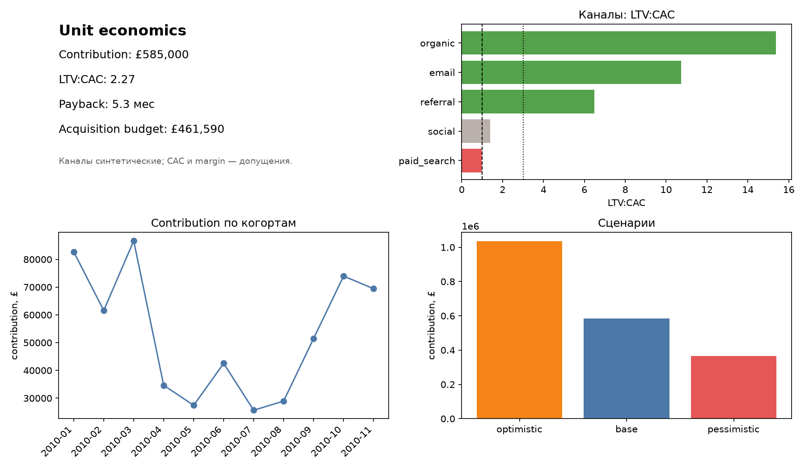
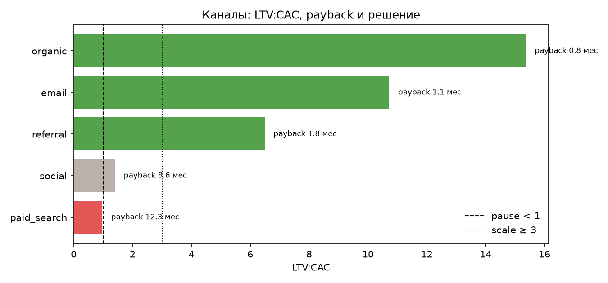
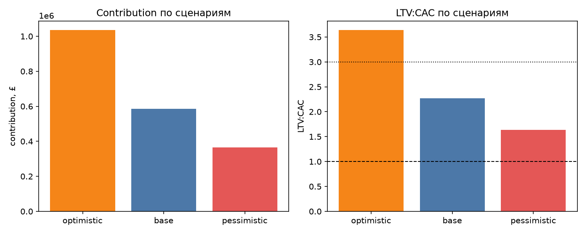
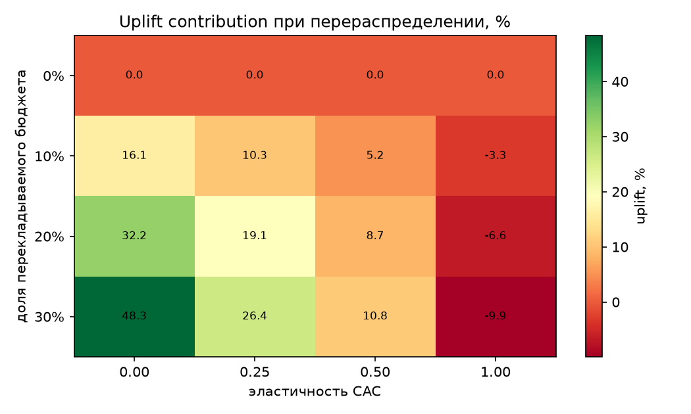
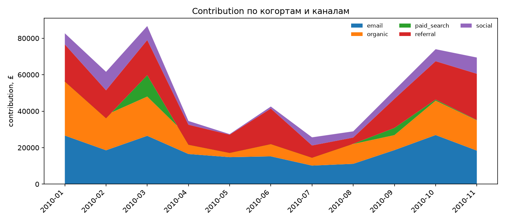

# Дашборд: юнит-экономика каналов

**TL;DR.** В базовом сценарии `paid_search` не окупается: LTV:CAC 0.97 и payback 12.3 месяца — канал на паузу; перекладывание 20 % бюджета keep-каналов в email/referral даёт +£50.8 тыс. contribution (+8.7 %), но только пока эластичность CAC ниже 0.8.

**Публичный дашборд:** https://datarw.github.io/product-analytics-portfolio/

## Вопрос

Бюджет привлечения распределён между каналами по историческому CAC. Какое распределение максимизирует окупаемость в горизонте 12 месяцев, если считать не CAC, а payback по прогнозному LTV? Решение — сценарий перераспределения бюджета и правило «канал на паузу».

Одним экраном дашборд отвечает: какие каналы недоокупаются, сколько бюджета освобождается, что происходит с contribution после перераспределения и при какой эластичности CAC действие перестаёт окупаться.

## Данные

Дашборд стоит на LTV-кейсе: 3 288 клиентов когорт 2010-01…2010-11, для которых есть прогнозный 12-месячный PV. Когорта 2009-12 исключена: это лево-цензурированная смесь, а не когорта привлечения.

| Поле | Что внутри |
|---|---|
| `customer_id` | клиент |
| `cohort` | месяц первой покупки |
| `country` | страна |
| `channel` | синтетический канал: paid_search, social, email, referral, organic |
| `first_check` | первый чек, £ |
| `pv` | прогнозный 12-месячный PV из LTV-кейса, £ |
| `ltv_gp` | gross-profit LTV = `pv × 1/1.364 × 0.30` |
| `cac` | сценарный CAC канала, £ |
| `contribution` | `ltv_gp − cac` |
| `ltv_cac` | `ltv_gp / cac` |
| `payback_months` | `cac / (ltv_gp / 12)` |

**Каналы синтезированы, а не наблюдаются.** Это сценарная надстройка: softmax по первому чеку назначает канал, CAC по каналам — допущение. Gross margin 30 % — допущение из LTV-кейса. В README, на дашборде и в `dashboard_meta.json` это помечено явно.

CAC-допущения: `paid_search` £320, `social` £200, `email` £30, `referral` £60, `organic` £20 (контент/SEO). Organic не масштабируется бюджетом и исключён из перераспределения.

## Определение метрики

**North Star:** 12-month contribution margin per acquired customer.

```
contribution_i = pv_i × (1 / 1.364) × 0.30 − CAC_channel(i)
```

Почему не revenue и не LTV по отдельности: revenue не учитывает стоимость привлечения, LTV — тоже. Contribution связывает доход и CAC в одной цифре. Драйверы — LTV (AOV, repeat rate, margin) и CAC (channel mix, auction); guardrails — payback ≤ 12 месяцев и LTV:CAC ≥ 1.

Портфельный LTV:CAC — отношение сумм, а не среднее индивидуальных отношений:

```
LTV:CAC = Σ ltv_gp / Σ CAC
payback = Σ CAC / (Σ ltv_gp / 12)
```

Поправка `1/1.364` — обратная величина calibration ratio LTV-кейса: модель переоценивала уровень на 36 %, поэтому в base LTV урезан. Optimistic — без поправки, pessimistic — ещё −10 % к LTV и CAC ×1.25.

## Метод

- **Витрина.** `case_dashboard/src/build_mart.py` собирает `dashboard_unit_economics.parquet` и SQLite `dashboard.sqlite`; представления — в `case_dashboard/sql/mart.sql`. Поля документированы в SQL-комментариях.
- **Каналы.** Softmax по стандартизованному первому чеку: дорогие чеки чаще email/referral, дешёвые — paid_search/social. Это сценарная связь LTV и канала, не наблюдение.
- **Unit economics.** Gross-profit LTV, CAC, contribution, LTV:CAC, payback; пороги: pause — LTV:CAC < 1 или payback > 12; scale — LTV:CAC ≥ 3 и payback ≤ 6; keep — иначе.
- **Сценарии.** Optimistic / base / pessimistic по LTV и CAC; считаются на одном и том же наборе клиентов.
- **Перераспределение.** 20 % бюджета keep-каналов перекладывается в scale-каналы; CAC получающих растёт: `cac_new = cac × (1 + elasticity × (budget_new/budget − 1))`. LTV на клиента постоянна — это сценарное допущение, не прогноз.
- **Дашборд.** Streamlit (`case_dashboard/app.py`) + статические скриншоты и HTML-превью на случай, если ссылка умрёт.



*Первый экран: contribution, LTV:CAC, payback и бюджет; каналы по LTV:CAC; contribution по когортам и сценариям. `paid_search` красный — ниже порога 1.0.*



*LTV:CAC по каналам с порогами 1 и 3; подпись — payback. Organic, email и referral — scale; social — keep; paid_search — pause.*

## Результаты

### Каналы, base

| Канал | Клиенты | Бюджет, £ | LTV:CAC | Payback, мес | Решение |
|---|---:|---:|---:|---:|---|
| organic | 576 | 11 520 | 15.37 | 0.8 | scale |
| email | 697 | 20 910 | 10.73 | 1.1 | scale |
| referral | 510 | 30 600 | 6.49 | 1.8 | scale |
| social | 692 | 138 400 | 1.40 | 8.6 | keep |
| paid_search | 813 | 260 160 | 0.97 | 12.3 | pause |

Портфель base: contribution **£584 999.82**, LTV:CAC **2.27**, payback **5.3 мес**, acquisition budget **£461 590**.

### Сценарии

| Сценарий | Contribution, £ | LTV:CAC | Payback, мес | Pause-каналов | Scale-каналов |
|---|---:|---:|---:|---:|---:|
| optimistic | 1 035 197 | 3.64 | 3.3 | 0 | 3 |
| base | 584 999.82 | 2.27 | 5.3 | 1 | 3 |
| pessimistic | 364 943 | 1.63 | 7.4 | 1 | 3 |

В pessimistic `paid_search` остаётся на паузе; в optimistic — не доходит до порога. Base — рабочая точка, optimistic/pessimistic — границы.



*Contribution и LTV:CAC по сценариям. Разброс contribution — 2.8× между pessimistic и optimistic; решение о паузе устойчиво в base и pessimistic.*

### Перераспределение

20 % бюджета keep-каналов (`paid_search`, `social`) перекладывается в scale-каналы (`email`, `referral`). При эластичности CAC 0.5:

| Показатель | Значение |
|---|---:|
| Перекладываемый бюджет | £27 680 |
| Contribution до | £584 999.82 |
| Contribution после | £635 807.03 |
| Uplift | £50 807.22 (+8.7 %) |
| Break-even эластичность | 0.80 |

При эластичности 1.0 тот же сдвиг даёт −£38 756 (−6.6 %): масштабирование съедает выигрыш. Это и есть строка «что меняется от самого действия».



*Uplift contribution в зависимости от доли перекладываемого бюджета и эластичности CAC. Зелёное — выигрыш, красное — потеря; при эластичности ≥0.8 сдвиг 20 % уже не окупается.*



*Contribution по когортам и каналам. 2009-12 исключена как лево-цензурированная смесь; 2010-когорты — когорты привлечения.*

## Что не сработало

- **Реальных каналов нет.** Каналы синтезированы, CAC — допущение. Дашборд показывает метод принятия решения, а не фактическую эффективность каналов Online Retail II.
- **LTV-модель переоценивает уровень.** Calibration ratio 1.364; без поправки `1/1.364` все каналы выглядят лучше, optimistic-сценарий это показывает. Base — консервативная точка, не «истина».
- **2009-12 исключена.** Это лево-цензурированная смесь, а не когорта привлечения; включать её в channel decision нельзя, но и переносить выводы на неё нельзя.
- **Постоянная LTV на клиента при масштабировании.** При росте бюджета канал может приводить более слабых клиентов; модель этого не знает. Эластичность CAC — только прокси.
- **Organic не масштабируется бюджетом.** Он в таблице для полноты, но исключён из перераспределения.
- **Публичная ссылка не развёрнута.** Streamlit работает локально, статические скриншоты и HTML-превью лежат в репозитории; для публичной ссылки нужен деплой (Streamlit Cloud / GitHub Pages) и решение о visibility репозитория.

## Рекомендация

1. **Paid_search — на паузу.** LTV:CAC 0.97, payback 12.3 месяца: канал не окупается в 12-месячном горизонте. Освобождаемый бюджет — £260 160 в текущей книге.
2. **Social — keep, не scale.** LTV:CAC 1.40, payback 8.6 месяца: канал выше порога, но далеко от scale-зоны. Масштабирование без роста CAC не обосновано.
3. **Email, referral, organic — scale.** LTV:CAC 6.5–15.4, payback 0.8–1.8 месяца. Это получатели перераспределения.
4. **Перекладывать 20 % бюджета keep-каналов, пока эластичность CAC < 0.8.** При 0.5 это +£50.8 тыс. contribution (+8.7 %); при 1.0 — минус. Решение принимается по предельной эластичности, а не по текущему LTV:CAC.
5. **Что меняется от самого действия.** Рост бюджета на scale-каналы поднимает CAC: аукцион и частота контакта дорожают. Держать CAC под контролем и пересчитывать break-even после каждого шага; для high-value сегмента ориентир — CAC cap £1 284 из LTV-кейса.

## Ограничения

- Каналы и CAC синтетические; нет атрибуции, реальных ставок и данных о насыщении. Выводы — сценарные, не фактические.
- Gross margin 30 % — допущение; COGS, скидки и налоги в данных отсутствуют.
- LTV — прогноз BG/NBD + Gamma-Gamma с калибровочной поправкой; ошибка модели переносится в unit economics.
- Только 2010-когорты; 2009-12 исключена, период 12 месяцев, сезонность не моделируется.
- LTV на клиента постоянна при перераспределении; нет saturation curve и adverse selection.
- Публичная ссылка на дашборд пока не развёрнута; локальный Streamlit и скриншоты — не то же самое, что публичный URL.

## Воспроизведение

Нужны данные LTV-кейса (`dashboard_unit_economics.parquet` собирается из `ltv_split.parquet`, `discounted.parquet`, `spend.parquet`). Данные лежат вне репозитория.

```bash
pip install -r requirements-dashboard.txt
python case_ltv/src/data.py
python case_ltv/src/execute_notebooks.py
python case_dashboard/src/build_mart.py
python case_dashboard/src/make_screenshots.py
python case_dashboard/src/execute_notebooks.py
streamlit run case_dashboard/app.py
```

Статическое превью: `case_dashboard/reports/dashboard.html`. На Windows:

```powershell
$env:PYTHONIOENCODING = 'utf-8'
```

Все числа README воспроизводятся `build_mart.py`, `make_screenshots.py` и ноутбуком `14-unit-economics.ipynb`; допущения — в `../data/processed/dashboard_meta.json` и `case_dashboard/sql/mart.sql`.
