# LTV: прогноз и сегментация клиентской базы

**TL;DR.** Минимальный верхний сегмент по прогнозному LTV — 9.8 % клиентов при пороге £3 580 — собирает 60.1 % выручки holdout; BG/NBD + Gamma-Gamma обыгрывает отраслевой мультипликатор B3 на 10.4 Gini-пункта (95 % CI 8.3–12.9), но статистически не отличается от исторической суммы B1 (−0.7 п.п., 95 % CI −1.4…0.02), поэтому модель применяю для ранжирования и `p(alive)`, а не как замену B1.

## Вопрос

Маркетинг тратит бюджет на ретаргетинг всей базы. Какие клиенты окупят вложение в горизонте 12 месяцев и сколько бюджета стоит перенести на верхний сегмент? Ответ нужен не в виде «средний LTV по базе», а в виде правила отбора: кого включить в приоритетный сегмент, при каком CAC это окупается и где модель перестаёт быть лучше простого деления на коэффициент.

Кейс проверяет не только модель, но и способ её проверки. Ранжирование и калибровка — ортогональные свойства: одна команда может выиграть по порядку и промахнуться по уровню, другая — наоборот. Поэтому каждая цифра ниже идёт с окном, бейзлайном и доверительным интервалом.

## Данные

**Online Retail II (UCI)**, транзакции британского онлайн-ритейлера подарков, 2009-12-01 → 2011-12-09. Лицензия CC BY 4.0, атрибуция обязательна: Chen, D. (2012), *Online Retail II*, UCI Machine Learning Repository, DOI 10.24432/C5CG6D.

| Показатель | Значение |
|---|---|
| Сырые строки / клиенты | 1 067 371 / 5 942 |
| После чистки | 794 078 строк, 5 852 клиента |
| Период | 2009-12-01 → 2011-12-09 (24,2 мес) |
| Отмены | 4,2 % оборота, остаются отрицательными строками |
| Клиенты с одной покупкой по счетам | 27,6 % |

Чистка идёт в фиксированном порядке (`case_ltv/src/data.py`): точные дубликаты → пустой `Customer ID` → служебные `StockCode` → `Price ≤ 0` → клиенты только с отменами. Порядок важен: числа ниже верны только для него.

| Шаг | Удалено строк | Осталось строк | Клиентов |
|---|---:|---:|---:|
| сырые данные | — | 1 067 371 | 5 942 |
| точные дубликаты | 34 335 | 1 033 036 | 5 942 |
| пустой `Customer ID` | 235 151 | 797 885 | 5 942 |
| служебные коды | 3 660 | 794 225 | 5 876 |
| `Price ≤ 0` | 60 | 794 165 | 5 875 |
| клиенты только с отменами | 87 | 794 078 | 5 852 |

Отмены не удаляю: нужна net-выручка. Две пары «заказ — полная отмена» (клиенты 16446 и 12346, ±£168 469,6 и ±£77 183,6) при фильтре «убрать отрицательные» дали бы выбросы.

Когорта 2009-12 (951 клиент против медианы 186) — не когорта привлечения: окно данных начинается 2009-12-01, туда попали и давние клиенты. Из когортных кривых B3/B4 она исключена, в фите BG/NBD остаётся; `T` у неё считается от первой покупки в окне, это смещение указано в «Ограничениях».

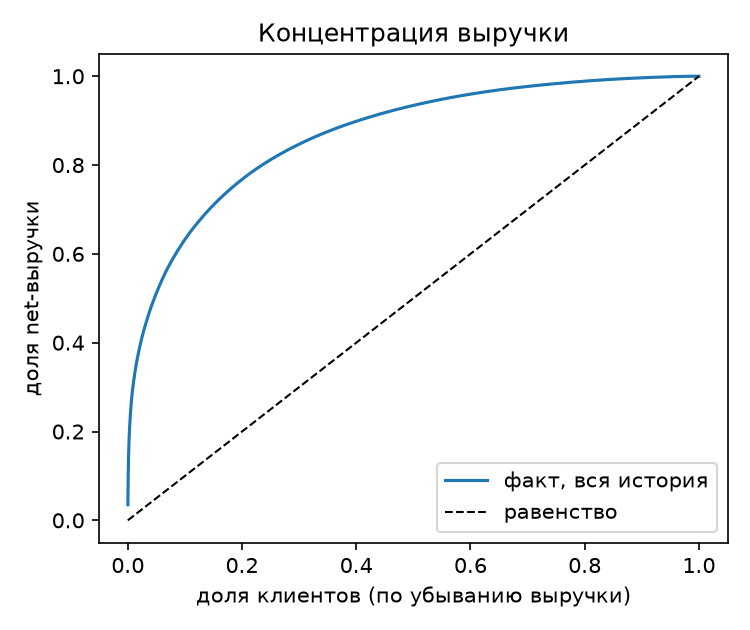

*Топ-10 % клиентов дают 63,2 % net-выручки, топ-20 % — 76,8 %, топ-1 % — 31,1 % (ноутбук 02). Это верхняя граница для сегментации: прогноз не может собрать больше, чем собирает сам факт.*

## Определение метрики

**LTV** — net-выручка после отмен в горизонте 12 месяцев от `cutoff_date`, в фунтах, без вычета себестоимости и маркетинговых издержек. `t0 = 2010-12-01`; калибровка — `date < t0`, holdout — `t0 ≤ date < t0 + 12 мес`. Валюта — GBP, потому что датасет в фунтах; net, потому что так считает финансовая отчётность и потому что отмены — 4,2 % оборота.

Формула для клиента `i`:

```
CLV_i = Σ_{m=0}^{11} E[purchases_{i,m}] × E[spend_i] / (1 + d_m)^(m + 0.5)
```

где `E[purchases_{i,m}]` — прирост ожидаемых покупок BG/NBD за месяц `m` (уже проинтегрирован по «жив/мёртв»), `E[spend_i]` — условное среднее чека Gamma-Gamma, `d_m` — месячная ставка дисконтирования. Покупки внутри месяца отношу к середине месяца.

**Дисконтирование — 10 % годовых**, месячная ставка `(1.10)^(1/12) − 1 = 0.797 %`. Это корпоративная норма доходности / стоимость капитала для ритейла; по данным она не измеряется, поэтому в ноутбуке 09 есть чувствительность 5/15 %. Дисконтирование меняет уровень CLV, но не порядок клиентов: общая кривая скидок монотонна, Gini остаётся 0.6972.

**Почему не `m / churn`, а `m · r / (1 + d − r)`.** `m / churn` — это сумма геометрического ряда `m + m·r + m·r² + …` при `d = 0`. С дисконтированием каждый член делится на `(1+d)^k`, и сумма равна `m·r / (1 + d − r)`. При `r = 0.96` и `d = 0.797 %` первая форма даёт 20.011m, вторая — 25.0m: разница −20 %. Чем выше удержание, тем сильнее ошибка; поэтому ставка и горизонт вынесены в определение, а не спрятаны в формулу.

**Monetary** — средняя net-выручка повторного дня с покупкой, не суммарная выручка клиента. Для `frequency = 0` monetary не определено; это не ноль, а отсутствие повторных покупок. В расчёт такие клиенты возвращаются с условным средним: `0.5 · first_check + 0.5 · population_mean`. Первый чек коррелирует с monetary при `x ≥ 1` (r = 0.42) и с holdout-выручкой (r = 0.43), поэтому он информативнее популяционного среднего; вес 0.5 фиксирован по reliability-аргументу, на holdout не подбирался.

## Метод

**Split.** Одна переменная `cutoff_date = 2010-12-01`. Калибровка 2009-12-01…2010-11-30 (12 мес), holdout 2010-12-01…2011-11-30 (12 мес). Holdout наблюдается полностью; неполный декабрь 2011 (9 дней) исключён, ноябрьский пик входит и в калибровку, и в holdout. В калибровке 4 239 клиентов, 393 869 строк, net-выручка £8 103 688. В holdout у этих клиентов 382 342 строки и £6 525 285. Ещё 1 585 клиентов впервые купили в holdout, 28 — после него; они не оцениваются, потому что признаков на cutoff для них нет.

557 отмен датированы раньше первой покупки клиента. Строки не удаляю, но исключаю из lifecycle-окон калибровки и holdout одним правилом; в holdout таких строк 3.

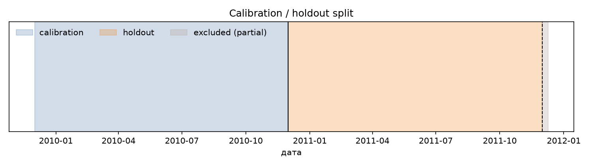

*Калибровка (синяя) и holdout (оранжевая) по 12 месяцев; серый хвост 2011-12-01…09 исключён. Holdout заканчивается 2011-11-30, поэтому ноябрьский пик попал в него целиком.*

**Признаки.** `frequency` — число повторных дней с покупкой (дней минус 1), `recency` — дней между первой и последней покупкой, `T` — дней от первой покупки до cutoff, `monetary` — средняя net-выручка повторного дня. Это конвенция `lifetimes`; RFM-recency («дней с последней покупки») хранится отдельно как `recency_rfm`. Все агрегаты строятся строго по `date < cutoff`.

**Бейзлайны.** B1 — историческая сумма калибровки. B2 — среднее по когорте привлечения (месяц первой покупки). B3 — мультипликатор: медиана `revenue_6m / revenue_60d` по когортам, перенесённая на 12 месяцев через когортную кривую `C(k)`. B4 — сумма когортной кривой выживания: `ARPU_i × Σ S(k)` с ассертом на убывание. B3 — отраслевой стандарт, а не формальность: он встретился в трёх из четырёх разобранных источников, и BG/NBD обязан обыграть именно его.

**Модели.** BG/NBD фитится байесовски на всех клиентах калибровки, включая `frequency = 0`: правдоподобие определено при `x = 0`, и такие клиенты несут информацию о параметрах отвала. 4 цепи × 500 draw, `r_hat max 1.0025`, `ess_bulk min 916`, 0 divergences. Gamma-Gamma фитится MLE только на клиентах с `frequency ≥ 1` (p = 2.181, q = 3.606, gamma = 505.3); клиенты с `x = 0` возвращаются в расчёт с условным средним. Pareto/NBD и MBG/NBD фитятся MLE для сравнения.

**Валидация.** Две оси всегда вместе. Ранжирование: Gini, кривая Лоренца, top-10 % capture и lift. Калибровка: MAE/RMSE и calibration ratio (`mean(pred)/mean(actual)`) по когортам, странам и децилям прогноза; флаг вне [0.8, 1.2]. Bootstrap по клиентам — 1 000 ресэмплов, один `numpy.random.Generator` из `RANDOM_SEED = 42`, передаётся явно. Сравнение моделей — парный bootstrap разницы на одних и тех же клиентах.

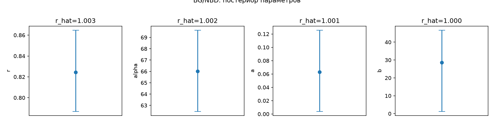

*Постериор четырёх параметров BG/NBD; подписи — `r_hat`. Диагностика читается из чисел (`az.summary`/`fit_summary`), не с графика.*

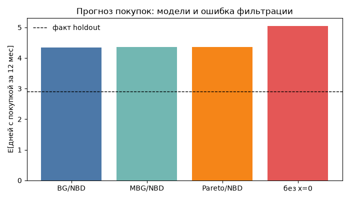

*BG/NBD, MBG/NBD и Pareto/NBD дают около 4.35–4.37 ожидаемых покупок за 12 месяцев; факт — 2.9 дня с покупкой. Фит без `frequency = 0` даёт 5.05: модель учится на «выживших» и переносит их поведение на всю базу.*

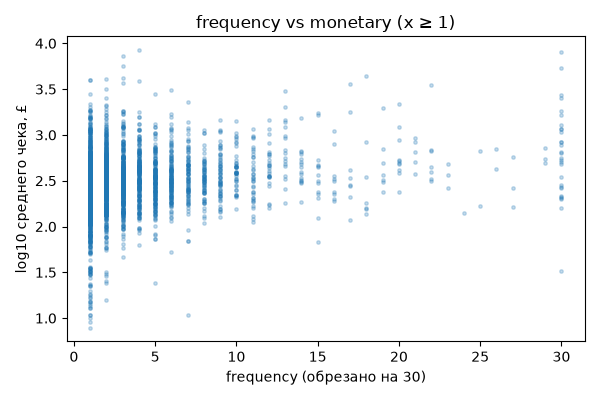

*Pearson 0.171, Spearman 0.199: линейной зависимости среднего чека от частоты нет, ранговая связь слабая. Допущение Gamma-Gamma в линейной форме не нарушено; остаточную ранговую связь отмечаю в ограничениях.*

## Результаты

### Модель × метрика на holdout

| Модель | Gini | Top-10 % capture | MAE, £ | Calibration ratio |
|---|---:|---:|---:|---:|
| B1 историческая сумма | 0.704 | 0.610 | 1 081 | 1.242 |
| B2 среднее по когорте | 0.348 | 0.276 | 2 113 | 1.242 |
| B3 мультипликатор | 0.593 | 0.507 | 2 128 | 1.730 |
| B4 кривая выживания | 0.628 | 0.525 | 1 466 | 0.865 |
| **BG/NBD + Gamma-Gamma** | **0.697** | **0.611** | **1 255** | **1.364** |
| MBG/NBD | 0.697 | 0.603 | 1 259 | 1.357 |
| Pareto/NBD | 0.697 | 0.603 | 1 267 | 1.356 |
| BG/NBD без `x = 0` | 0.686 | 0.605 | 1 484 | 1.527 |

BG/NBD обыгрывает B3 на **+0.1039 Gini** (95 % CI 0.0834…0.1287) и на **+0.1042 top-10 capture** (0.0750…0.1314). Против B4 преимущество **+0.0688 Gini** (0.0531…0.0871). Против B1 разница **−0.0065 Gini** (−0.0143…0.00025) и **+0.0011 top-10 capture** (−0.0206…0.0108): интервалы пересекают 0, то есть на этом окне BG/NBD и историческая сумма неразличимы. Против MBG/NBD и Pareto/NBD разница тоже неотличима от нуля: три частотные модели дают один и тот же порядок.

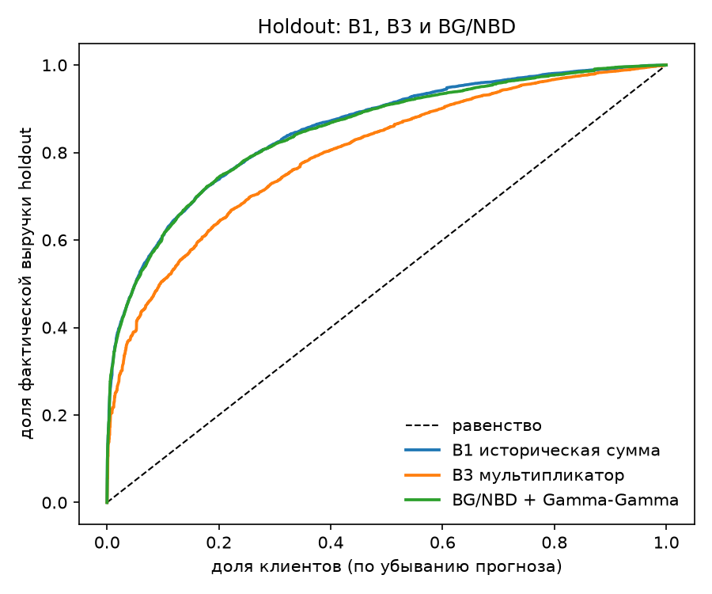

*B1 (синяя) и BG/NBD (зелёная) идут почти вплотную; B3 (оранжевая) заметно ниже. Gini: 0.704 / 0.697 / 0.593. Разница BG/NBD с B3 значима, с B1 — нет.*

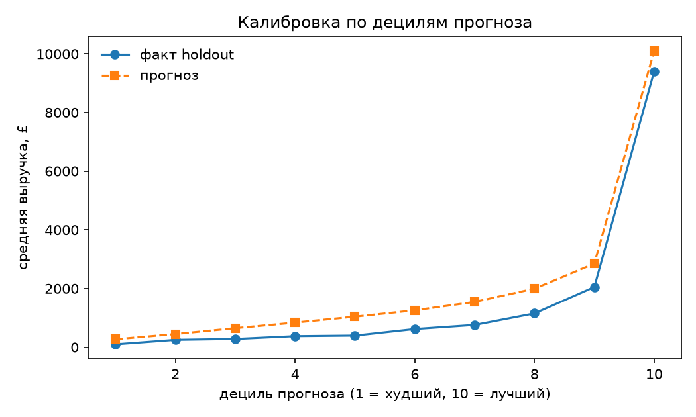

*Факт против прогноза по децилям BG/NBD. Выше 1-го дециля модель систематически выше факта; calibration ratio 1.364, флаг вне [0.8, 1.2] у 10 из 12 когорт, 4 из 7 стран, 9 из 10 децилей. Модель переоценивает уровень, но сохраняет порядок.*

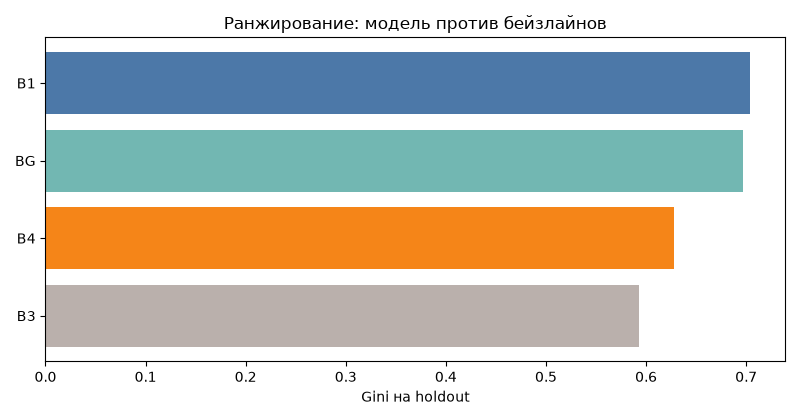

*Gini на holdout: B1 0.704, BG/NBD 0.697, B4 0.628, B3 0.593. Историческая сумма — сильнейший бейзлайн; модель обыгрывает отраслевые B3/B4, но не B1.*

### Горизонт и дисконтирование

| Горизонт | Прогноз BG/NBD | Факт holdout |
|---:|---:|---:|
| 6 мес | £1 036 | £637 |
| 12 мес | £2 072 | £1 539 |
| 24 мес | £4 144 | нет наблюдения |

6 и 12 месяцев наблюдаются, 24 — экстраполяция: данные кончаются 2011-12-09. 12 месяцев выбраны как самый длинный полностью наблюдаемый горизонт и типичный цикл планирования. Дисконтирование 10 % годовых снижает 12-месячный уровень с £2 072 до £1 976 (−4.6 %); Gini не меняется (0.6972 vs 0.6972).

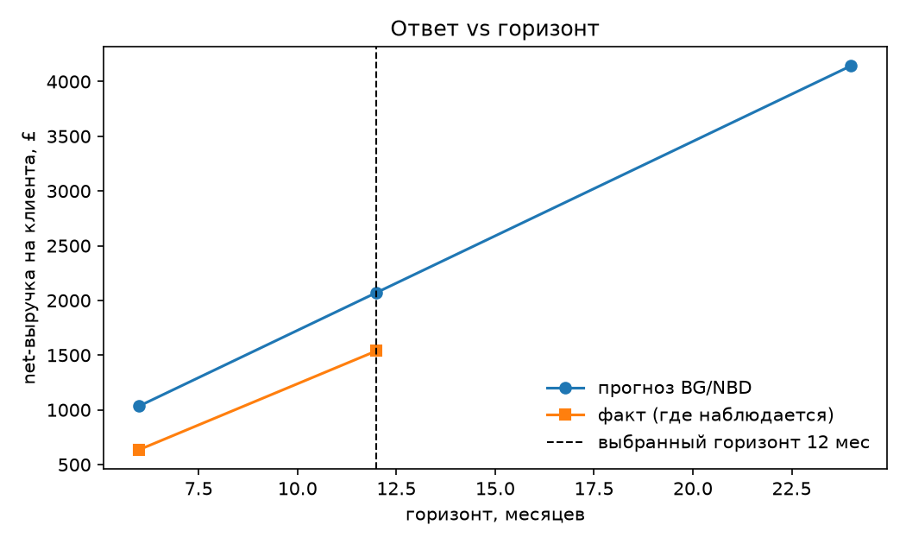

*Прогноз растёт почти линейно, факт — медленнее; расхождение к 6 месяцам 1.63×, к 12 — 1.35×. 24 месяца показаны пунктиром как прогноз, не как факт.*

### Сегментация

Порог high-value выбран по покрытию выручки, а не по квинтилю: минимальный верхний сегмент, который собирает 60 % фактической выручки holdout, — **£3 580 прогнозного LTV**. Это **417 клиентов (9.8 %)**, покрытие **60.1 %**. Медианная фактическая выручка сегмента — **£4 280.76**; при марже 30 % CAC cap = **£1 284.23** на клиента.

| Сегмент | Клиенты | Доля клиентов | Доля выручки holdout | Средняя выручка, £ | Медиана, £ |
|---|---:|---:|---:|---:|---:|
| high-value | 417 | 9.8 % | 60.1 % | 9 409 | 4 281 |
| B (одна покупка) | 1 480 | 34.9 % | 6.3 % | 276 | 0 |
| остальные | 2 342 | 55.2 % | 33.6 % | 937 | 453 |

Сегмент B — 34.9 % клиентов, но 6.3 % выручки. Индивидуальный прогноз на одной транзакции шумный, поэтому применяю shrinkage к среднему по группе «страна × бэнд первого чека»: `w = n/(n+10)`, для сегмента B `w ≈ 0.09`. Gini внутри B растёт 0.308 → 0.365, но MAE ухудшается 648 → 1 516 £. Shrinkage помогает порядку и вредит уровню; для отбора — да, для абсолютного прогноза — нет.

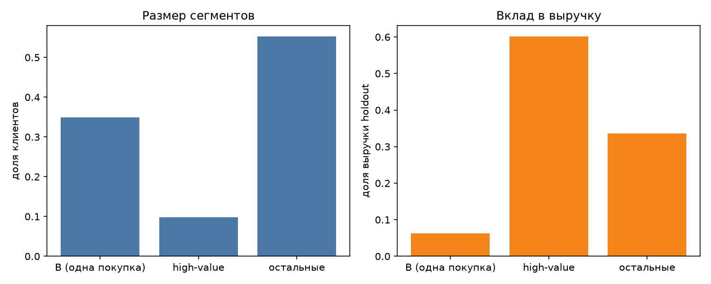

*Слева размер сегментов, справа вклад в выручку holdout. 9.8 % клиентов дают 60.1 % выручки; сегмент B — 34.9 % клиентов и 6.3 % выручки.*

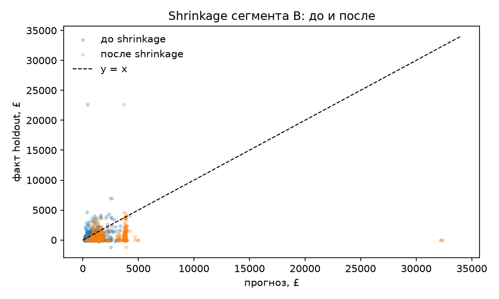

*Прогноз до и после shrinkage против факта. Точки после shrinkage теснее по ranking (Gini 0.308 → 0.365), но дальше от диагонали по уровню (MAE 648 → 1 516 £).*

## Что не сработало

- **B1 не обыгран.** BG/NBD 0.697 против 0.704 у исторической суммы; разница −0.0065, 95 % CI −0.0143…0.00025. На 12/12-сплите размер клиента уже виден в калибровке, и модель не добавляет точности к порядку. Это граница применимости, а не повод прятать результат.
- **Фит без одноразовых покупателей.** Исключение `frequency = 0` даёт 5.05 ожидаемых покупок против факта 2.9 и calibration ratio 1.53. Популярный совет «filter out one-time buyers» на этих данных ухудшает прогноз.
- **Pareto/NBD и MBG/NBD не лучше BG/NBD.** Gini 0.697 у всех трёх, интервалы разницы пересекают 0. Pareto уходит в `beta → ∞`, MBG — в `b → 100`; AIC формально чуть лучше у Pareto, но параметр на границе, поэтому AIC не защищает выбор.
- **Калибровка уровня.** Calibration ratio 1.364; флаг вне [0.8, 1.2] у 10 из 12 когорт, 4 из 7 стран, 9 из 10 децилей. Псевдо-holdout внутри калибровки даёт 0.86 (6/6) и 0.70 (9/3) и не предсказывает направление ошибки; глобальная поправка не обоснована.
- **Shrinkage сегмента B.** Gini 0.308 → 0.365, но MAE 648 → 1 516 £: групповое среднее помогает порядку и вредит уровню.
- **B3 на 12 месяцах не оценивается без утечки.** Первые 12 месяцев когорт 2010-01…2010-11 заканчиваются после cutoff. 6-месячный прокси даёт pooled multiplier 1.532 и переоценку уровня 1.73; ranking (Gini 0.593) хуже B1 и BG/NBD, но лучше B2.
- **24-месячный горизонт не наблюдается.** £4 144 — экстраполяция, не факт.
- **Календарные когорты против возрастных.** На возрасте 1 разница −1.0 п.п., стд. отклонение разностей 3.8 п.п.; эффект не подтверждён и не опровергнут. Метод возрастных когорт заявляю, выигрыш — нет.

## Рекомендация

1. **Отбирать бюджет по ранжированию, не по абсолютному LTV.** High-value — верхние 9.8 % по прогнозному LTV с порогом £3 580; этот сегмент собирает 60.1 % выручки holdout. Абсолютный уровень модели переоценён на 36 %, поэтому для финансового плана его нельзя брать без калибровки.
2. **CAC cap — £1 284 на клиента** при марже 30 % и медианной фактической выручке £4 281. Это не «LTV», а верхняя граница стоимости привлечения, при которой сегмент окупается.
3. **Что меняется от самого действия.** Рост бюджета на сегмент поднимает CAC: аукцион и частота контакта дорожают, а часть сегмента купила бы без стимула. Поэтому правило — не «увеличить бюджет на high-value», а «перераспределять бюджет, пока предельный CAC ниже £1 284». Это общая форма ошибки Альфа-Банка: высокий прогноз дохода не является разрешением на действие без модели издержек.
4. **Сегмент B (одна покупка) — не для индивидуального CLV.** 34.9 % клиентов дают 6.3 % выручки; работа с ними — групповые касания по «страна × бэнд первого чека», а не персональный прогноз. Shrinkage улучшает порядок, но не уровень.
5. **Для существующих клиентов B1 остаётся сильным и дешёвым вариантом.** BG/NBD применяю для `p(alive)`, для клиентов с короткой историей и для сегментации; заменой исторической сумме он на этом окне не является.

## Ограничения

- 12 месяцев калибровки и 12 месяцев holdout — максимум при 24,2 месяцах данных. Когорта 2009-12 лево-цензурирована, настоящей даты привлечения нет; модель предполагает стационарность и не знает сезонности/тренда.
- Уровень BG/NBD переоценён на 36 %; calibration ratio вне [0.8, 1.2] у большинства срезов. Модель пригодна для ранжирования и `p(alive)`, не для финансового прогноза без калибровки.
- Считаю net-выручку, а не маржу: COGS, скидки и налоги в данных отсутствуют. Маржа 30 % в рекомендации — сценарное допущение, а не измеренная величина.
- Gamma-Gamma: Pearson(frequency, monetary) 0.171, Spearman 0.199 — линейное допущение не нарушено, ранговая связь слабая, но есть. Pareto/NBD и MBG/NBD на границе параметров; их AIC не интерпретирую как выбор.
- Нет канала привлечения и CAC: юнит-экономика по каналам не строится. Рекомендация задаёт CAC cap, а не готовый бюджет.
- Бюджетное решение меняет будущие данные: если распределять бюджет по прогнозу, следующая обучающая выборка смещена решениями модели (degenerate feedback loop). Лечится резервированием доли бюджета на случайную аллокацию до запуска таргетинга.

## Воспроизведение

Требуется Python 3.12 и пакеты из `requirements.txt` (версии прибиты). Данные в репозиторий не входят.

```bash
git clone <repo-url> product-analytics-portfolio
cd product-analytics-portfolio
python -m venv .venv
.venv\Scripts\activate          # Windows
# source .venv/bin/activate     # Linux/macOS
pip install -r requirements.txt
```

Скачайте `online_retail_II.xlsx` со страницы UCI (DOI 10.24432/C5CG6D) и положите **рядом с репозиторием**, в `../data/raw/online-retail-ii/`:

```
Product_Analytics_Portfolio/
├── product-analytics-portfolio/   ← этот репозиторий
└── data/
    └── raw/online-retail-ii/online_retail_II.xlsx
```

Затем:

```bash
python case_ltv/src/data.py
python case_ltv/src/execute_notebooks.py
```

`data.py` строит `../data/processed/transactions.parquet` (794 078 строк). `execute_notebooks.py` прогоняет ноутбуки 01–10 с нуля и сохраняет вывод; ноутбук 06 (байесовский BG/NBD) занимает около двух минут, весь прогон — около десяти. На Windows перед запуском:

```powershell
$env:PYTHONIOENCODING = 'utf-8'
```

Проверка гигиены репозитория:

```bash
python sync_check.py --audit
```

Ноутбуки читают пути только через `paths.py`; литеральных `../../data/` в коде нет. Все числа README воспроизводятся ячейками ноутбуков 04–10; рабочие журналы и данные в публичный репозиторий не входят.
